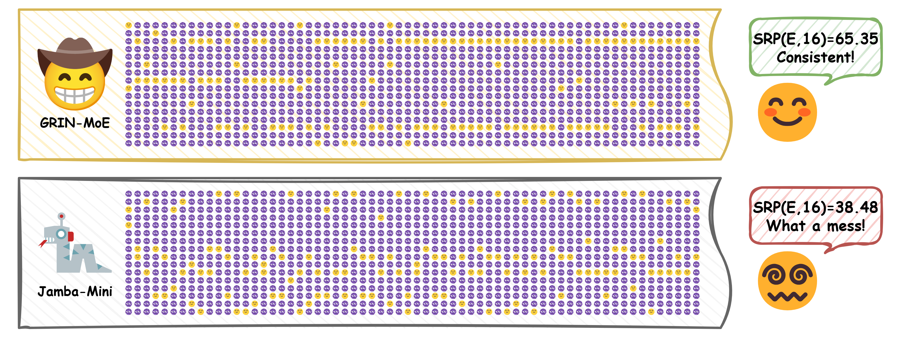

# Not All Models Suit Expert Offloading: On Local Routing Consistency of Mixture-of-Expert Models

This is the codebase for:
<p align=center><i>Not All Models Suit Expert Offloading:<br>On <b>Local Routing Consistency</b> of Mixture-of-Expert Models</i></p>
<p align=center>[<a href="https://arxiv.org/abs/2505.16056">📄Paper</a>] • [<a href="https://github.com/ljcleo/moe-lrc">💻Code</a>]</p>



## Requirements

We recommend using [uv](https://docs.astral.sh/uv/) to setup a Python environment. Due to an issue of `causal-conv1d`, you might need to run `uv venv` and `uv pip install setuptools torch` before running `uv sync`.

## Usage

1. **[Download data files](data/README.md)**
2. **[Download model files](model/README.md)**
3. **[Run scripts and notebooks!](src/README.md)**

## Cite

```bibtex
@inproceedings{liang2026not,
title={Not All Models Suit Expert Offloading: On Local Routing Consistency of Mixture-of-Expert Models},
author={Jingcong Liang and Siyuan Wang and Miren Tian and Yitong Li and Duyu Tang and zhongyu wei},
booktitle={The Fourteenth International Conference on Learning Representations},
year={2026},
url={https://openreview.net/forum?id=2XMAUP74ig}
}
```
